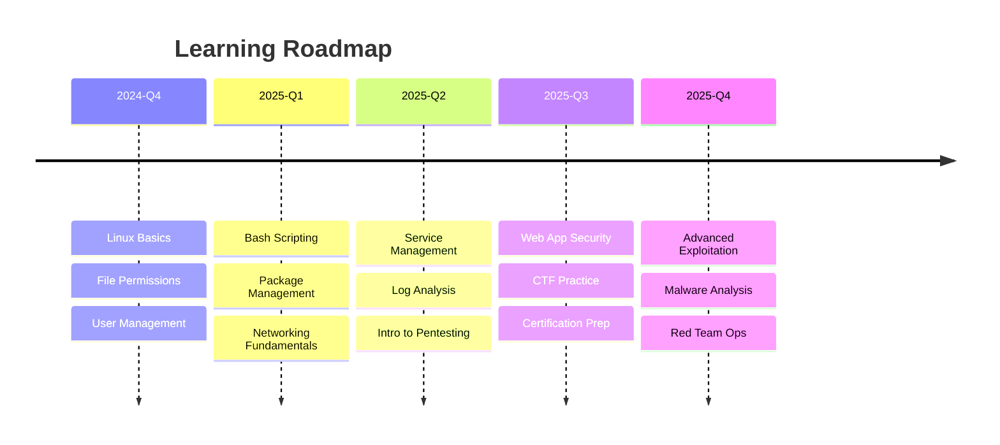

<p align="center">
  
</p>

<p align="center">
  
</p>

---

## 🚀 About Me

```yaml
name: Kisholoy
pronouns: He/Him
location: India
focus: Linux | Bash | Networking | Cybersecurity | Pentesting
current_quest: "Mastering the art of offensive & defensive security"
learning_style: Hands-on | Documenting everything | Building in public
```

<details>
<summary><b>🎯 Current Mission</b></summary>

> **Documenting my hands-on journey** from Linux basics to advanced cybersecurity — one commit at a time.  
> Building a public knowledge base that grows with me.

</details>

---

## 🛠️ Tech Stack & Tools

<p align="center">
  
</p>

| Category | Tools & Technologies |
|----------|---------------------|
| **OS & Shell** | Kali Linux, Ubuntu, Bash, Zsh, PowerShell |
| **Scripting** | Python, Bash, Shell scripting |
| **Networking** | Nmap, Wireshark, Netcat, tcpdump, curl/wget |
| **Security** | Burp Suite, Metasploit, Hydra, John, Hashcat, Gobuster |
| **Web** | HTTP/HTTPS, DNS, SSL/TLS, OWASP Top 10 |
| **DevOps** | Git, Docker, CI/CD basics, Vim/Neovim |
| **Learning** | TryHackMe, Hack The Box, PortSwigger Academy |

---

## 📊 GitHub Stats

<p align="center">
  
  
</p>

<p align="center">
  
</p>

---

## 🗂️ Featured Projects

| Project | Description | Stack | Status |
|---------|-------------|-------|--------|
| [**linux-cybersecurity-journey**](https://github.com/KisholoyDD21/linux-cybersecurity-journey) | Daily documented journey: Linux → Bash → Networking → Pentesting | Markdown, Bash, Kali | 🟢 Active |
| [**capacity-connect**](https://github.com/KisholoyDD21/capacity-connect) | Capacity planning & connectivity tool | Python, Networking | 🟡 In Progress |
| [**gods-eye-view**](https://github.com/KisholoyDD21/gods-eye-view) | Network monitoring & visualization | Python, Bash, APIs | 🟡 In Progress |
| [**woman_safety_app**](https://github.com/KisholoyDD21/woman_safety_app) | Safety application with alerting system | Python, Flask, Twilio | 🟢 Complete |

---

## 📅 Learning Journey (Public)



> **Current Phase:** 🟢 **Linux Fundamentals** — Days 1-3 complete  
> **Next Up:** Bash scripting, package management, networking basics

---

## 🏆 Achievements & Badges

<p align="center">
  
</p>

---

## 📈 Activity Graph

<p align="center">
  
</p>

---

## 🤝 Let's Connect

<p align="center">
  <a href="https://linkedin.com/in/kisholoydd21"></a>
  <a href="https://twitter.com/KisholoyDD21"></a>
  <a href="mailto:kisholoy.paul@gmail.com"></a>
  <a href="https://tryhackme.com/p/KisholoyDD21"></a>
  <a href="https://app.hackthebox.com/users/XXXXXX"></a>
</p>

---

## 💡 Philosophy

> **"The expert in anything was once a beginner."**  
> Learning in public keeps me accountable, helps others, and builds a portfolio of proof — not just promises.

<p align="center">
  <i>⭐ Star my repos if they help you • 🍴 Fork to start your own journey • 📬 Open to collabs & mentorship</i>
</p>

---

<details>
<summary><b>🎨 Profile Customization Credits</b></summary>

- Typing SVG: [readme-typing-svg](https://github.com/DenverCoder1/readme-typing-svg)
- Stats Cards: [github-readme-stats](https://github.com/anuraghazra/github-readme-stats)
- Streak Stats: [github-readme-streak-stats](https://github.com/DenverCoder1/github-readme-streak-stats)
- Activity Graph: [github-readme-activity-graph](https://github.com/Ashutosh00710/github-readme-activity-graph)
- Trophies: [github-profile-trophy](https://github.com/ryo-ma/github-profile-trophy)
- Skill Icons: [skill-icons](https://github.com/tandpfun/skill-icons)
- Mermaid Diagrams: Native GitHub support

</details>